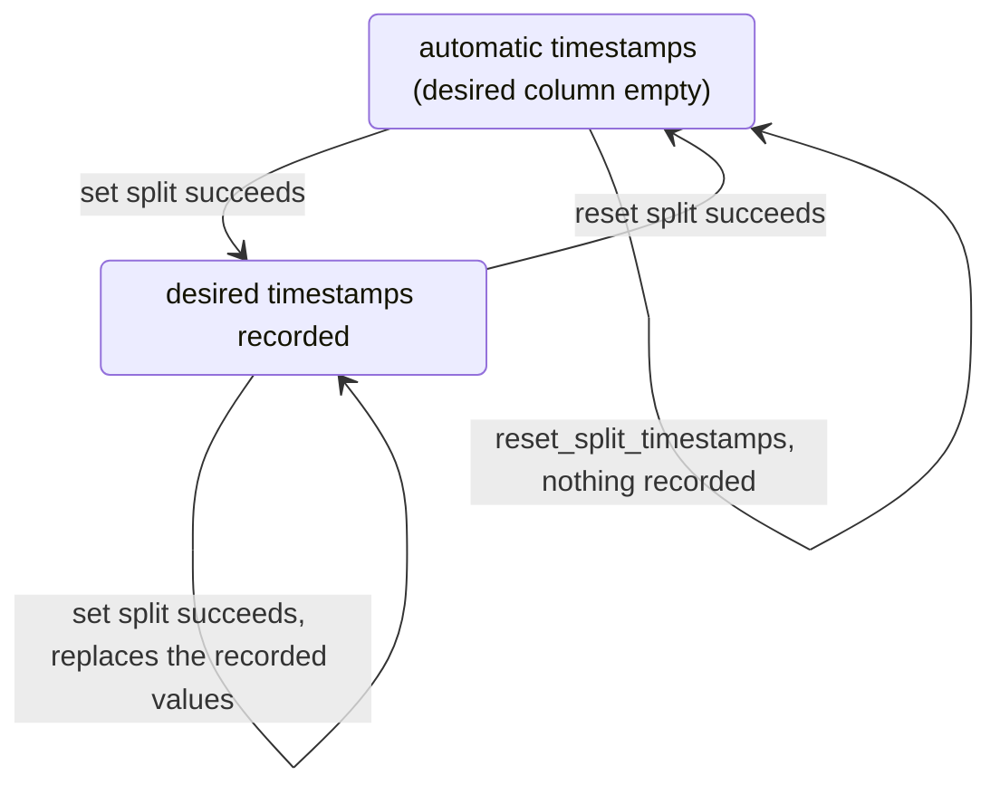

# Split-timestamp operations behind `Concerts` (#166)

Tracer bullet for [#166](https://github.com/gregwebs/tiny-desk-splitter/issues/166),
the split-timestamp slice of the [deep concert modules
specification](https://github.com/gregwebs/tiny-desk-splitter/issues/158).

## What was already there

The interface itself landed with the playback slice (#162): `Concerts` already
had `split_timestamps`, `set_split_timestamps`, and `reset_split_timestamps`, and
the three routes were already thin callers. Auditing the ticket's acceptance
criteria against `main` found four things still open.

## What changed

| Area | Change |
| --- | --- |
| `concerts.rs` | A change returns `SplitTimestampChange::{Accepted(SplitStart), Rejected(SplitTimestampRejection)}`. The rejection carries the typed `CommandRejection` reason and the latest Concert State, the same split [`JobRequestOutcome`] already used. |
| `concerts.rs` | `SplitTimestampRejection` means "expected refusal"; the `Err` arm is reserved for genuine faults. `latest_state` is now the one place a rejection picks up its state, shared with `JobRequestOutcome`. |
| `concerts.rs` | `set_split_timestamps` takes `Vec<ProposedTimestamp>` instead of an HTTP payload. |
| `concerts.rs` | `reset_split_timestamps` refuses while a split is still running, instead of reporting "already automatic" over work that a user-timestamp split is about to record. |
| `split_timestamps.rs` | Owns `ProposedTimestamp` (a title and a window per song, before validation derives the duration). No longer owns any wire type. |
| `split_timestamps.rs` | The wire types moved to `web/handlers.rs`: `TimestampPayload`, `TimestampPayloadSong`, `SplitTimestampsResponse`, `SplitStartResponse`, `SplitStartStatus`, plus the two `From` impls. The workflow and the Job Run it starts no longer depend on a serialization format. |
| `web/handlers.rs` | One `split_timestamp_change_response` for both change routes; the read uses the generic `concert_command_error` instead of a third near-identical mapping. |
| `jobs/{split,split_library,mod}.rs` | Take `ProposedTimestamp`, like the workflow. |
| `docs/concerts.md`, `docs/data.md` | The interface shape, the timestamp state transitions, and what a change may refuse. |

No route, payload, or markup changed. The JSON bodies are byte-identical: the
component names in the OpenAPI document are the type names, which did not change,
only the module they are defined in.

## Timestamp state transitions

A change is recorded only when the split that applies it succeeds. Admission
starts that split; until then the stored timestamps are whatever they were.

A failed or cancelled split leaves the recorded timestamps as they were, and
neither change touches the recorded download.

Three readings are worth recording, because each surprised a test written for this
slice:

- **The desired column is written on success, not on admission.** A user-timestamp
  split records its values in its terminal commit, so between admission and that
  commit the column is still empty. A second change in that window is refused
  (`Conflict`, "a split job is already running for this concert") rather than
  queued — see the review follow-up below.
- **Reset is "already automatic" before it is "the analysis is stale".** With no
  desired timestamps recorded, reset has nothing to drop, so it answers
  `AlreadyAuto` even when the stored analysis no longer covers the set list.
  `SetListChangedSinceAnalysis` is reachable only when the caller actually has
  desired timestamps to drop.
- **An absent source is a conflict, an unobservable one is a different conflict.**
  The interface refuses a change whose source cannot be observed *at all* before
  the workflow runs, and the workflow refuses a source that is observably gone.
  Both are `Conflict`, but they mean different things to the person reading them:
  "we cannot look" is not "it is not there".

## Review follow-up

An adversarial review found one defect, now fixed:

- **Reset could report a false success while a user-timestamp split was still
  running.** `reset_to_auto_timestamps` returned `AlreadyAuto` on the strength of
  the stored desired column alone, and that column is written only when the split
  succeeds. Resetting while such a split was in flight therefore answered
  `200 {"status":"already-auto"}` and did nothing, after which the running split
  stored the desired timestamps anyway. `Concerts::replay_auto_timestamps` now
  observes split activity first and refuses with the same `Conflict` admission
  would have reported. A split merely queued behind a download does not refuse:
  that one is the automatic analysis, which records no desired timestamps.

  Regression test: `resetting_a_split_that_is_still_running_is_a_conflict`, using
  a blocking split command so the window is real rather than raced. Mutation
  check: replacing the guard with a condition that never fires makes that test
  fail with `Invalid { "No automated split timestamps available…" }` — the
  refusal the reviewer's reproducer got, one refusal later.

- The review also caught that the first draft of this record and of
  `docs/concerts.md` described the transitions as happening at admission. Both now
  state the commit-time rule and the refusal in the running window.

## Preserved behaviour

- The three routes, their request and response bodies, and their status codes:
  202 for an admitted split, 200 for "already automatic", 404 for an absent
  concert, 409 for a conflict, 422 for an invalid change with the reason as plain
  text, 500 for a fault. 422 rather than the generic mapping's 400 is this
  protocol's long-standing contract for the editor.
- The read still returns `media_duration` as `null` rather than absent when the
  source is missing, which the timeline relies on.
- Resetting still never reads the source file.
- The one behavioural change: a reset requested while a split is running now
  answers 409 instead of 200. It was 200 only when no desired timestamps were
  recorded yet, which is exactly the window in which the answer was wrong. No
  route, body, or status changed for any other request; the hurl files that pin
  these contracts pass unchanged.

## Tests

Interface (`concerts.rs`), replacing assertions that expected the old `Err`
shape and adding the cases the ticket lists:

- `split_timestamps_read_the_stored_values` — the automatic timestamps come back.
- `a_user_defined_change_starts_the_split_and_reports_the_state_it_ran_in` — the
  one case needing a source file `ffprobe` accepts (`real_audio` seed): accepted,
  `Splitting`, and the returned state is the one with the split running.
- `resetting_timestamps_does_not_need_the_source_file` — `AlreadyAuto`, accepted,
  with state.
- `resetting_without_automatic_timestamps_is_an_invalid_rejection` and
  `resetting_with_analysis_that_no_longer_covers_the_set_list_is_an_invalid_rejection`
  — the two `Invalid` reset refusals, each carrying the state.
- `resetting_a_split_that_is_still_running_is_a_conflict` — a blocking split
  command keeps the window open, so reset is refused instead of reporting a
  success the running split would undo.
- `timestamp_validation_failures_are_invalid_rejections_carrying_the_state`.
- `a_change_without_a_source_file_is_a_conflict_carrying_the_state` — and the
  carried observation is a *known* absent source.
- `timestamp_changes_refuse_an_unobserved_source_instead_of_assuming_it_is_absent`
  — known-absent and unobservable are different facts.
- `a_rejected_change_can_be_retried_with_a_corrected_payload`.
- `split_timestamp_commands_reject_an_absent_concert` — a change answers
  `Rejected(NotFound)` with no state; the read stays an `Err`.
- `a_one_shot_process_reports_that_it_cannot_admit_split_work` — `Operational`.

Adapter (`web/handlers.rs`), translation only:

- `a_timestamp_payload_parses_into_proposed_boundaries`.
- `the_timestamp_read_answers_the_editor_payload`.
- `every_split_timestamp_route_answers_404_for_an_absent_concert`.
- `a_timestamp_rejection_answers_this_protocols_status_and_message` — 422 with
  the reason text, not the generic 400.
- `a_timestamp_change_without_a_source_answers_409`.
- `the_reset_route_answers_the_accepted_status_as_json` — 200 with
  `{"status":"already-auto"}`.

## Verification

Artifacts were built in a scratch target dir under `/tmp`
(`CARGO_TARGET_DIR=/tmp/tds-target`): the checkout volume holds 24 G of `videos/`
out of 27 G, so an in-repo debug link fails. `Dockerfile.dev` documents the recipe.

- `cargo fmt --all -- --check` — clean
- `cargo clippy --workspace --all-targets -- -D warnings` — exit 0
- `cargo nextest run --tests` — 967 passed, 0 skipped (957 before this change)
- `cargo nextest run --tests -p concert-tracker --features test-control` — 808
  passed, 0 skipped (798 before this change)
- `node scripts/hurl-test.js` — 14 files, 299 requests, 100%
- `npx playwright test` — 173 passed
- `./scripts/shellcheck.sh`, `./scripts/ts-check.sh`, `./scripts/ts-lint.sh` — exit 0

## Follow-on notes

- The `ProposedTimestamp` conversion is the seam a future JSON adapter uses: the
  interface never sees a body, so a second transport adds a payload type beside
  the existing one and nothing else.
- `split_timestamps::probe_media_duration` still calls `ffprobe` directly rather
  than through an injected probe, which is why one interface test depends on a
  real generated m4a and on `ffmpeg` being on `PATH`. If a second consumer needs
  a deterministic probe, that is the seam to add — the same shape as
  `MetadataRefreshFn`.
- #168 (contract legacy concert paths) is the remaining slice; the routes here
  are already adapter-only.
