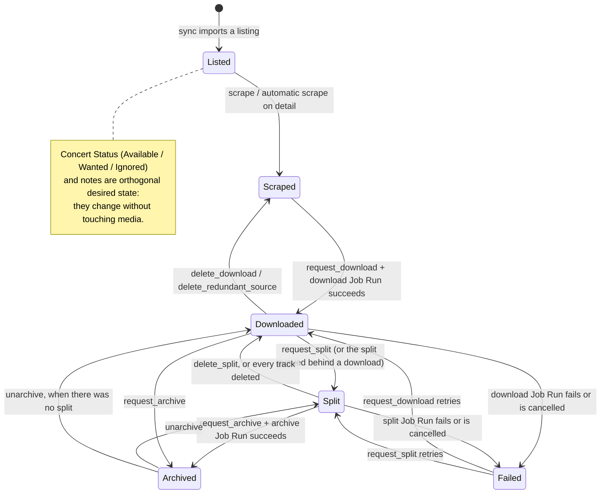

# Concert application interface

`concert-tracker::concerts::Concerts` is the presentation-neutral application
interface for one concert. It is long-lived and shared by adapters: the HTMX
listing, detail page, and fragments, the Test Control API, and the `concert-db`
CLI all observe and command concerts through `Concerts` and `ConcertCatalog`.
Nothing outside this module reaches into the tables, the media inventory, the
Job Registry, or the Scrape Queue to describe a concert.

Two modules make up the interface:

- `Concerts` owns individual concert queries and commands.
- `Concerts::catalog`, a separate module, owns browsing the collection
  (`ConcertCatalog`). See [Concert Catalog](#concert-catalog).

`ConcertState` is the canonical point-in-time description of a concert. It
combines:

- persisted metadata and download, split, and archive lifecycle;
- persisted per-track presence and like state;
- independently observed source and Published Concert Split media;
- persisted and in-memory active work;
- whether archiving is configured;
- the actions currently permitted by those facts.

Event history and Failed Job history are intentionally excluded. They are
unbounded audit data and are loaded explicitly through
`Concerts::event_history` and `Concerts::failed_job_history`.

## State changes

Concert State is derived, never stored: every command re-observes and hands back
a fresh `ConcertState`. The transitions a user can cause are:



Two invariants make these transitions safe to retry:

- **Desired state, not toggles.** Concert Status is stored as a target
  (`set_status`), so a retried request cannot flip the user's choice back.
- **Idempotent media commands.** Deletions and Job Requests converge: asking for
  media that is already absent, or for a Job Run that is already active, reports
  the current state instead of failing.

Commands that change media are not mutually exclusive at the storage layer: a
delete request during a Job Run, or an archive request while a split is running,
is admitted and does what it says. The listing and detail cards hide those
controls while work is active (`PermittedActions`), so this is only reachable by
calling the endpoints directly, and it is unchanged from before the interface
existed. Making cross-kind exclusion atomic needs a persistent guard, which is
tracked separately rather than smuggled into this interface.

Failure is a terminal lifecycle outcome, not a fault: `download_status`,
`split_status`, and `archive_status` record it, Failed Job history keeps the
reason, and a new request moves the concert back out of it.

## Observation semantics

Filesystem facts use `Observation<T>`:

- `Known(present/absent)` means the relevant directory was successfully
  observed.
- `Unknown(reason)` means the application could not safely distinguish
  presence from absence.

Source media and Published Concert Split media are independent observations.
For example, a publication-lock failure makes split media Unknown while a
successful source-directory scan can still prove the source is present.
Actions that require an Unknown fact are unavailable. Operational persistence
errors are not domain observations: they propagate as
`ConcertQueryError::Operational`.

```text
Concerts::get(id)
  |
  +--> DB lock: concert + timestamps + settings
  |       `--> absent row -------------------------------> NotFound
  |
  +--> fallible source scan
  |       +--> readable --------------------------------> Known
  |       `--> I/O failure ------------------------------> Unknown
  |
  +--> shared Published Concert Split lock + scan
  |       +--> readable --------------------------------> Known
  |       `--> lock/I/O failure -------------------------> Unknown
  |
  +--> ScrapeQueue + JobRegistry ------------------------> ActiveWork
  |
  `--> pure policy --------------------------------------> PermittedActions
```

The result is internally consistent at observation time, not a global atomic
snapshot across SQLite, the filesystem, and in-memory registries. Future
commands must re-read their own preconditions.

## Active-work consistency

For each Download, Split, and Archive Job Run, `JobActivity` retains both the
persisted `*_started_at` fact and `JobRegistry::is_running`. Either one counts
as active. This fails closed during admission, completion, recovery, or
inconsistency windows rather than permitting a conflicting operation.

A queued download-to-split dependency counts as split activity and makes tracks
busy. Scrape activity remains separate, as required by
[ADR 0006](adr/0006-scrape-queue-separate-from-job-registry.md).

## Commands

A command method states the result the user wants and returns the resulting
Concert State, so an adapter can re-render without a second query.

| Method | Desired state it sets |
| --- | --- |
| `Concerts::set_status(id, ConcertStatus)` | Available, Wanted, or Ignored |
| `Concerts::set_notes(id, notes)` | the concert's notes text |

Commands express desired state rather than toggling storage. `set_status`
writes both stored flags from one `ConcertStatus`, so Wanted and Ignored can
never coexist, and asking for the status a concert already has is a no-op that
records no event: a retried request cannot reverse the user's choice. Becoming
Ignored also discards the cached preview image and listing thumbnail, which are
disposable copies of scraped images.

Adapters may keep a toggle-shaped surface — the HTMX card's Ignore/Want buttons
and their ✕ counterparts, and `concert-db ignore`/`want` — because translating a
click into "the status the user picked" is a presentation concern. The interface
still receives the desired status, and still enforces the invariant.

Expected rejections are separate from operational failures:

```text
set_status / set_notes
  |
  +--> absent concert row ---------------------------> Rejected(NotFound)
  +--> the command conflicts with observed facts ----> Rejected(<typed reason>)
  +--> persistence failure --------------------------> Operational(error)
```

`ConcertCommandError` is that pair. Adapters map a rejection onto a client error
of their own protocol and an operational failure onto a server error; they never
turn a rejection into a server error.

## Playback resolution

Playback resolution returns a presentation-neutral description and never
records anything. The caller decides whether that description goes to a
browser player or a system player, and how to build a URL for it.

| Method | Returns |
| --- | --- |
| `Concerts::playback(id)` | the whole-concert plan: source file, else the reconstruction sequence |
| `Concerts::source_media(id)` | the source file as whole-album playback |
| `Concerts::track_media(id, index)` | one track, with `has_next`, `has_prev`, and like state |
| `Concerts::next_track_media` / `prev_track_media` | the next/previous playable track |
| `Concerts::reconstruction_items(id)` | the interleaved song/interlude sequence |
| `Concerts::track_details(id)` | per-track availability, video flag, and like state |
| `Concerts::media_file(id, target)` | the file a system player should open |

`ConcertPlaybackError` keeps three situations apart: no such concert
(`NotFound`), nothing to play (`Lookup(NotPlayable)`), and the concert is
recorded as downloaded but the file is gone
(`Lookup(MarkedDownloadedButMissing)`). Adapters report the first two as absent
and the last as a data-integrity failure, which is why the source-file decision
lives in one place.

A media description carries `playable` and `is_video` because the two players
are not interchangeable. Concert Media Inventory discovers more containers than
a browser can decode — `.mkv` is the standing example — so `source_media` and
`track_media` describe such a file (`playable: false`) and `media_file` still
resolves it for a system player, while `next_track_media`, `prev_track_media`,
and the reconstruction sequence only ever offer media a browser can play. A
source in an unsupported container therefore still plays as
`PlaybackPlan::Source`, with `playable: false` telling the adapter to hand it to
the system player; a concert whose only *split* media is unsupported has nothing
to reconstruct, which is `Lookup(NotPlayable)` rather than a missing-media
rejection.

Recording is explicit:

| Method | Effect |
| --- | --- |
| `Concerts::record_listen(id, target)` | records a listen for the whole concert or one track |
| `Concerts::record_watch(id, target)` | records that the listener opened that media |
| `Concerts::set_track_liked(id, index, liked)` | sets the desired like state |

`ListenTarget` names the whole concert or one track. A listen or watch whose
media is absent is rejected rather than recorded, so a failed play does not
become audit history. `set_track_liked` rejects a track that is not in the set
list and one whose file is absent, and repeating the same desired state records
no second event.

## Deletion

Deletion states the desired end result — the media is absent — so every
deletion method is idempotent: asking again after the media is gone succeeds and
returns the current Concert State instead of reporting a failure. Identities
that were never valid are still rejections, so retrying a request for a track
that does not exist cannot look like success.

| Method | Desired absent state |
| --- | --- |
| `Concerts::delete_download(id, DeletionConfirmation)` | the source file and its recorded download |
| `Concerts::delete_redundant_source(id)` | the source file, once song and interlude media cover it |
| `Concerts::delete_split(id)` | the recorded split |
| `Concerts::delete_track(id, index)` | one track's media files |
| `Concerts::delete_interlude(id, index)` | one interlude's media files |

`DeletionOutcome` is `Deleted` or `ConfirmationRequired`. The second exists for
one case: the database records a download whose file is already gone, so
repairing the record is destructive enough to need
`DeletionConfirmation::Confirmed`. A rejection — `SourceNotRedundant`,
`NoSuchTrack`, `MissingMedia` — means the request cannot have the effect it asks
for; `SourceNotRedundant` in particular is the coverage gate refusing to delete
audio that the tracks do not contain.

Mutation stays inside Concert Media Inventory. Canonical discovery decides which
files an operation touches, so deleting a track removes its media whatever
extension it is in, and no adapter builds a path, an extension, or a sanitized
name of its own.

## Job Requests

| Method | Effect |
| --- | --- |
| `Concerts::request_download(id)` | admits the source-media download, and the split that follows it when there is something to split |
| `Concerts::request_split(id)` | admits a split of the downloaded source |
| `Concerts::prepare(id)` | makes every track playable: scrape when needed, then the download → split chain |
| `Concerts::cancel_job(id, kind)` | cancels the active Job Run of that kind |

`request_download`, `request_split`, and `prepare` return a `JobRequestOutcome`:

```text
request_download / request_split / prepare
  |
  +--> admitted, already active, or nothing to do ----> Accepted(JobRequestResult)
  |        the admission decision and the Concert State
  |        observed after persistent admission
  |
  +--> the concert cannot do it -----------------------> Rejected(JobRejection)
  |        the precise typed reason, and the latest
  |        Concert State when the concert still exists
  |
  `--> a genuine fault --------------------------------> Err(Operational)
```

`Accepted` carries the admission decision (`Admitted`, `AlreadyRunning`, or
`NothingToDo`) and the Concert State observed after persistent admission, so an
adapter re-renders without a second query and a batch tool can report "skipped,
source missing" without asking the Job Registry. `Rejected` carries the same
`CommandRejection` vocabulary as the other commands, plus the state the concert
was refused in — only an absent concert has no state to attach. Expected
refusals are values and faults are errors, as for every other command.

Requests are idempotent: a second download while one is running is accepted and
keeps its queued split, a repeated `prepare` reports `AlreadyRunning` rather than
starting a second chain, and `prepare` on a concert that already has every track
reports `NothingToDo`. Nothing to do is not an error: a split request for a
concert whose source is not downloaded is accepted and changes nothing, and
`cancel_job` reports `JobCancellation::NothingActive` rather than failing.

A request the concert cannot satisfy is a rejection: `prepare` on a concert with
no set list is `Invalid` (422 — the user can fix it by scraping), and an unknown
concert is `NotFound`. The rejection's Concert State is what lets an adapter that
has somewhere to render it show why nothing started, while this HTML adapter
answers with the reason alone.

Failure is a terminal lifecycle outcome, not a fault: a failed or cancelled run
leaves `download_status` or `split_status` unsuccessful and writes one Failed Job,
and the next request admits a fresh run. A download that fails drops the split
queued behind it, so a retried request queues a new one.

`PermittedActions` and admission read the same observation, so a control the state
offers is a command the interface accepts. Download, split, and archive are Job
Runs — the Job Run engine still owns race-safe admission, dependency edges,
exactly one terminal outcome, and Failed Job history; `Concerts` is where a
request becomes one.

## Archive

| Method | Effect |
| --- | --- |
| `Concerts::request_archive(id)` | admits the Job Run that moves the media into the archive location |
| `Concerts::unarchive(id)` | moves the media back and clears the archive lifecycle |

Archiving is a Job Run, so it has admission, cancellation, and Failed Job
history like download and split. Nothing to archive (no download and no split) is
an outcome, `ArchiveOutcome::NothingToArchive`, not a failure.

Unarchiving is deliberately **not** a Job Run: it repairs one symlink in place, so
it has no admission race, no cancellation, and no recovery pass of its own. The
interface still owns all of it — eligibility (archived, no archive in flight, has
an album), the filesystem work on a blocking thread, the lifecycle update on
success, and the failure record plus Failed Job entry on failure — so an adapter
cannot invent half of the workflow. A failed unarchive leaves the record
unchanged, which makes a retry fail the same way instead of reporting a restored
concert.

## Scrape

| Method | Effect |
| --- | --- |
| `Concerts::scrape(id)` | re-fetches this concert's metadata and reports the refreshed state |
| `Concerts::ensure_scraped(id)` | scrapes only when metadata is absent, tolerating failure |

A scrape is not a Job Run: it runs on the Scrape Queue's worker, which is a
separate protocol (ADR-0006). Nothing here invents a scrape Job Run, a recovery
pass, or a cancellation for one. `ensure_scraped` keeps the long-standing
tolerance — a failed automatic scrape is logged and the command that wanted the
metadata proceeds without it — while an explicit `scrape` reports the failure.

## Split timestamps

| Method | Effect |
| --- | --- |
| `Concerts::split_timestamps(id)` | automatic and desired timestamps plus the source duration |
| `Concerts::set_split_timestamps(id, payload)` | stores the desired timestamps and starts the split that applies them |
| `Concerts::reset_split_timestamps(id)` | starts the split that restores the automatic timestamps |

The change methods return a `SplitStart`: the immediate outcome (splitting, or
already automatic) and the Concert State observed right after admission.

Timestamp work needs the source file, and "we could not look" is not "it is not
there". When the source cannot be observed — an unreadable concert directory, a
publication lock that will not open — the command is refused with
`CommandRejection::Conflict` instead of being attempted on a guess. Validation
and coverage failures are rejections too: `Invalid` for values the concert cannot
accept, `Conflict` for a state that cannot accept the request. Adapters map them
onto 422 and 409, and keep operational failures as server errors.

A process that runs no Job Runs cannot admit split work. `Concerts::without_workers`
(a one-shot CLI) reports that as an operational error rather than pretending the
change was accepted.

## Concert Catalog

`ConcertCatalog::browse(filter)` is how adapters browse the collection. It
returns canonical `ConcertState` values — not a listing-only projection — so the
listing and the detail page describe the same facts and cannot disagree about
status or available actions. Applying a filter is `ConcertFilter::matches`, and
the filter vocabulary is the existing one: All, Wanted, Available, Ignored,
Downloaded, Split (shown as "Tracks"), and Archived. Archived degrades to All
when archiving is not configured, as it always has.

Month grouping, the order rows appear in the page, terminal formatting, and HTML
stay adapter concerns: the HTMX listing and `concert-db list` share the catalog
and differ only in presentation.

The catalog is a separate module because collection browsing is where compound
filters, search, stable ordering, and infinite-scrolling cursor pagination are
planned. None of those exist yet and none are modeled: when they are specified
they land behind the catalog without touching individual-concert commands. That
is why `browse` takes one filter and returns the whole result rather than
pre-modeling a query object.

Browsing reads the database once for the whole collection, including user split
timestamps (one query, not one per concert), and then observes each concert
exactly as `Concerts::get` does. Collapsing the two paths is deliberate: it is
what makes a listing card show the same availability the detail page shows.

## Adapter boundary

Adapters may translate canonical state into labels, URLs, HTML, or a future
transport representation. They must not rescan media, inspect the Job Registry
or Scrape Queue, query the concert tables, or derive action policy. Concretely,
for anything that describes or commands a concert, an adapter calls `Concerts` or
`ConcertCatalog` and nothing else.

Three things stay outside this interface on purpose, because they are not
concert state:

- **Settings** (`db::settings`) — application configuration such as the archive
  location and theme.
- **Failed Job history** (`db::failed_jobs`) — engine records, listed on the Jobs
  page and read through `Concerts::failed_job_history` when a concert's history is
  wanted.
- **Batch row selection in the one-shot CLI** — maintenance verbs that choose rows
  across the whole collection (`scrape` of every concert missing a teaser,
  `resplit` candidates, `reset-in-progress`, stale-error clearing). These are
  table-wide batch operations, not interaction with one concert, and inventing
  catalog queries for them would add vocabulary no filter needs. The commands
  they then issue — for example `resplit`'s split requests — do go through
  `Concerts`. Every concert card — a listing card, a
card swapped in place after a command, and the detail page card — is one
template over Concert State; the only differences are which image it uses,
whether the track list is embedded, and whether the background-scrape
placeholder can appear.

## Test seam

`Concerts` and `ConcertCatalog` are the primary test seams. Tests use a fresh
in-memory SQLite database, `db::seeds::SeedContext`, a temporary media
directory, and real `JobRegistry` and `ScrapeQueue` state (or
`Concerts::without_workers` for a one-shot process that has no workers at all).
Tests assert public state, history, and command outcomes; they do not mock
internal collaborators or inspect private call structure. Adapter tests cover
translation only — request parsing, response shape, and markup — never concert
policy, which is why filter behaviour is asserted once, against the catalog. See
[Backend persistence: testing persistence-backed modules](backend-persistence.md#testing-persistence-backed-modules).
